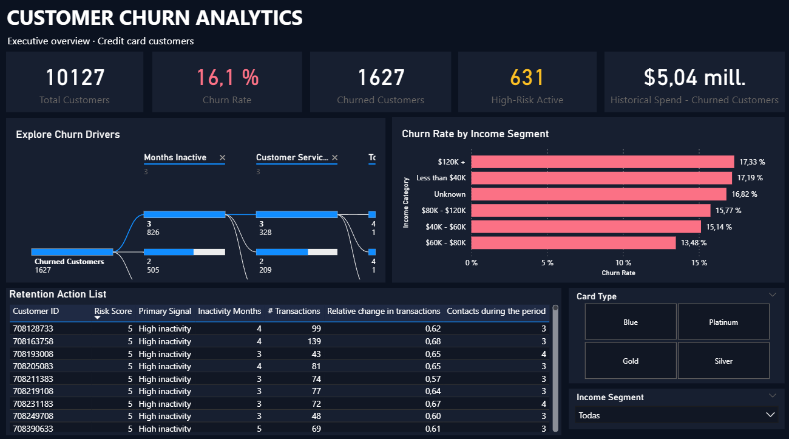
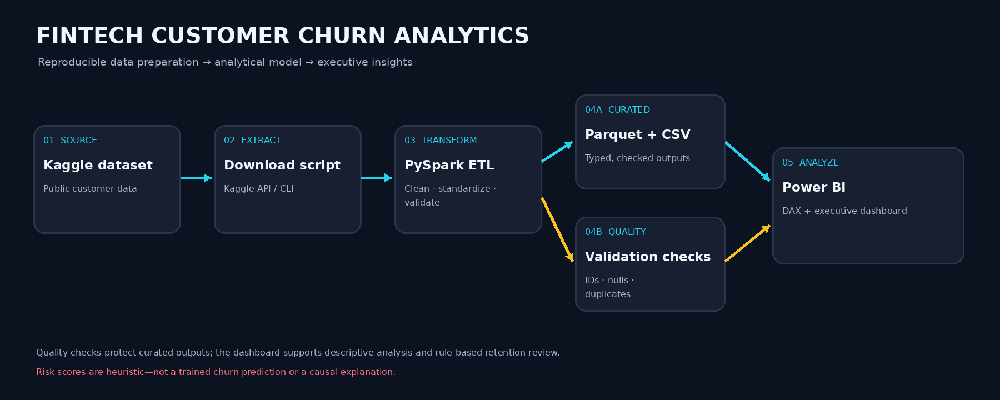
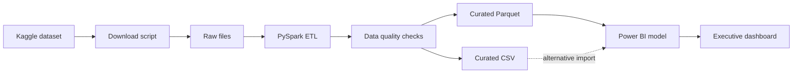

<div align="center">

# FinTech Customer Churn Analytics

**An end-to-end customer churn analytics project using Python, PySpark, Parquet, and Power BI.**

[](https://www.python.org/)
[](https://spark.apache.org/docs/latest/api/python/)
[](https://powerbi.microsoft.com/)
[](https://pandas.pydata.org/)
[](https://parquet.apache.org/)
[](#limitations)

</div>

---

## Overview

**FinTech Customer Churn Analytics** demonstrates a reproducible data preparation pipeline and an interactive executive dashboard built from a public credit-card customer dataset.

The project combines data engineering practices—automated dataset retrieval, Spark transformations, data-quality checks, and columnar storage—with business intelligence using DAX measures and Power BI visuals.

The goal is to explore historical customer attrition, compare segments, and identify active customers who meet transparent, rule-based criteria for further retention review.

> **Scope note:** This is an educational portfolio project, not a production banking system. The risk score is heuristic, not a trained predictive model, and descriptive associations do not establish causation.

## Business questions

1. How large is the customer base, and what share has already churned?
2. How does observed churn vary across customer segments?
3. Which attributes are associated with customers who have churned?
4. Which active customers meet the project's rule-based high-risk criteria and may warrant review?

## Dashboard preview

<p align="center">
  
</p>

**To add the dashboard screenshot:** save a clean screenshot of the finished Power BI page as `assets/executive-overview.png`, then commit it. Keep the image genuine and ensure all labels are legible.

## Data source

The project uses the public [Credit Card Customers dataset on Kaggle](https://www.kaggle.com/datasets/sakshigoyal7/credit-card-customers). The source contains **10,127 customer records**.

The ETL pipeline removes the two Naive Bayes classifier output columns, standardizes column names, applies data types, handles missing categorical values, and checks customer-ID and target integrity. Review Kaggle's dataset page and terms before reusing the data. This repository does not claim ownership of the source dataset.

## Architecture





## Technology stack

| Technology | Purpose |
|---|---|
| Python | Automation and ETL orchestration |
| Kaggle API / CLI | Dataset retrieval |
| Apache PySpark | Data cleaning, standardization, type handling, and validation |
| Pandas | Supporting data utilities where required by the environment |
| Parquet | Columnar curated data output |
| CSV | Portable output for inspection and BI import |
| Power BI | Interactive dashboard and visualization |
| DAX | KPI measures and rule-based customer-risk logic |
| Git / GitHub | Version control and documentation |

## Repository structure

```text
fintech-customer-churn/
├── data/
│   ├── raw/                         # Downloaded source files
│   └── curated/
│       ├── customer_churn/          # Parquet output directory
│       └── customer_churn_csv/      # CSV output directory
├── docs/
│   └── data_dictionary.md
├── powerbi/
│   └── customer_churn_dashboard.pbix
├── scripts/
│   ├── download_data.py
│   └── etl_churn.py
├── assets/
│   ├── executive-overview.png
│   └── pipeline-architecture.png
├── requirements.txt
└── README.md
```

## Getting started

### 1. Prerequisites

- Python installed and available from your terminal.
- A Java JDK compatible with your PySpark version.
- Kaggle account and API credentials.
- Power BI Desktop to open and interact with the `.pbix` report. Power BI Desktop is a Windows application; Linux users need a supported Windows or remote environment.

### 2. Clone the repository

```bash
git clone https://github.com/Fab0705/fintech-customer-churn.git
cd fintech-customer-churn
```

### 3. Create a virtual environment and install dependencies

**Windows (PowerShell):**

```powershell
python -m venv .venv
.venv\Scripts\Activate.ps1
pip install -r requirements.txt
```

**macOS / Linux:**

```bash
python3 -m venv .venv
source .venv/bin/activate
pip install -r requirements.txt
```

### 4. Configure Kaggle API access

Follow the [official Kaggle API instructions](https://github.com/Kaggle/kaggle-api) to configure credentials. Never commit `kaggle.json`, API tokens, or other secrets.

### 5. Download the source dataset

Run from the repository root:

```bash
python scripts/download_data.py
```

The script is expected to download and extract the dataset into `data/raw/`.

### 6. Run the ETL pipeline

```bash
python scripts/etl_churn.py
```

The pipeline writes curated Parquet and CSV outputs under `data/curated/`. Parquet is the preferred output for analytical storage; CSV is available for inspection and BI import.

**Java note:** If Spark reports that `JAVA_HOME` is not set, install a JDK compatible with your PySpark version and configure `JAVA_HOME` before rerunning the pipeline.

### 7. Open the Power BI report

1. Open `powerbi/customer_churn_dashboard.pbix` in Power BI Desktop.
2. If prompted, update the data source path to the curated output on your machine.
3. Refresh the model and verify the KPI values.
4. Use the card-category and income-category slicers to explore the dashboard.

Depending on how the `.pbix` was authored, Power BI may connect to the CSV file or Parquet output. Update the source settings if your local paths differ.

## Data engineering workflow

The ETL pipeline is designed to:

1. Retrieve the public dataset through the Kaggle CLI.
2. Load the source data with PySpark.
3. Remove the two Naive Bayes classifier output columns.
4. Standardize field names using `snake_case`.
5. Apply appropriate types to numeric and categorical columns.
6. Replace missing or blank categorical values with `Unknown`.
7. Report missing values and duplicate customer IDs.
8. Validate that the customer identifier and target label are present.
9. Export curated data to Parquet and CSV.

### Validation snapshot

The successful local run reported:

| Check | Result |
|---|---:|
| Input customer records | 10,127 |
| Duplicate customer IDs | 0 |
| Null customer IDs | 0 |
| Null target labels | 0 |

The run also reported zero nulls in the inspected columns. These figures describe the recorded run, not a guarantee that future source-file versions will have identical quality.

## Key metrics

| Metric | Definition |
|---|---|
| Total Customers | Distinct count of customer identifiers |
| Churned Customers | Customers whose target label is `Attrited Customer` |
| Active Customers | Customers whose target label is `Existing Customer` |
| Churn Rate | Churned customers divided by total customers in the current filter context |
| High-Risk Active Customers | Active customers meeting the report's defined heuristic risk rules |
| Historical Transaction Volume — Churned Customers | Sum of `total_trans_amt` for customers labeled as churned |

The Power BI model also includes derived fields such as `Operational Risk Score`, `Operational Risk Band`, `Age Band`, `Credit Limit Band`, and `Primary Risk Signal`.

### Interpreting risk responsibly

- The operational risk score is a **rule-based heuristic**, not a machine-learning prediction or calibrated probability.
- Risk thresholds are assumptions for this portfolio project and should be calibrated against business objectives and historical outcomes before operational use.
- `total_trans_amt` is historical transaction volume. It should not be described as lost revenue, profit, lifetime value, or money the bank definitively lost.
- The dataset is a snapshot, not a dated monthly history. This project does not establish a true month-over-month churn trend or prove causation.
- Churn rate describes observed labels in the dataset; it is not a forecast of future churn.

## Data dictionary

See [`docs/data_dictionary.md`](docs/data_dictionary.md) for field definitions, logical types, business interpretations, and notes about derived fields.

## Recommended visuals

1. **Dashboard screenshot** — `assets/executive-overview.png`, captured from the actual report in Power BI.
2. **Pipeline architecture** — `assets/pipeline-architecture.png`, included in this repository.
3. **ETL run evidence** — a cropped terminal screenshot showing row count, duplicate-ID count, null checks, and successful output paths. Remove personal paths and credentials.
4. **Optional detail screenshot** — a close-up of the decomposition tree and retention table if the full-page screenshot makes them difficult to read.

Use real screenshots and verified results. Avoid visuals or wording that imply predictive accuracy or financial impact not established by the analysis.

## Limitations and future improvements

- Add automated tests for schema, nulls, duplicate IDs, and output generation.
- Add structured logging, clearer error handling, and configurable paths.
- Produce a data-quality report and document rejected-record handling.
- Validate heuristic risk thresholds using documented business assumptions and historical evidence.
- If dated data becomes available, analyze churn over time or develop and evaluate a predictive model with appropriate validation.
- Document the Power BI source connection so the report can be refreshed on another machine.

## License

No license has been specified yet. Add a `LICENSE` file before presenting the repository as open source. Review the original Kaggle dataset's license and terms separately; this repository's license does not automatically change the dataset's terms.

## Acknowledgments

- Dataset: [Credit Card Customers — Kaggle](https://www.kaggle.com/datasets/sakshigoyal7/credit-card-customers).
- Tools: Python, Apache Spark, Power BI, and the open-source ecosystem around them.
